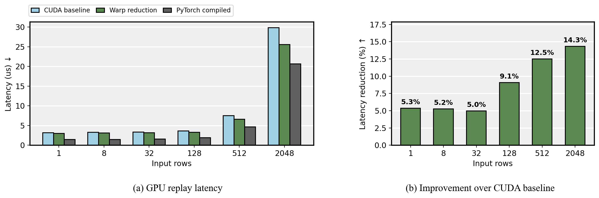

# GPU Kernel Lab

CUDA C++ operator development with PyTorch bindings, numerical tests and hardware profiling. The project covers normalization and matrix multiplication, with implementations and measurements added in stages.

## Validation

**NVIDIA L4 · PyTorch 2.8.0 · CUDA 12.8 · FP32 / FP16 / BF16**

| Check | Result |
|---|---:|
| CUDA extension compile and first load | 17.49 s |
| Python-to-CUDA smoke cases | 18 passed |
| Correctness and execution-semantics tests, both variants | 98 passed |
| Separate RMSNorm numerical cases, both variants | 192 passed |

[Validation results](results/validation.md) · [Current numerical evidence](results/rmsnorm-warp-correctness.json)

## RMSNorm reduction optimization

Warp-shuffle reduction cuts block-wide barriers from **9 to 2** and static shared storage from **1024 to 32 bytes per block**. On L4, BF16 GPU replay latency falls by **5.0%–14.3%** across 1–2048 rows at width 1536.

| Rows | CUDA baseline | Warp reduction | Latency reduction |
|---:|---:|---:|---:|
| 1 | 3.183 us | 3.012 us | 5.3% |
| 128 | 3.616 us | 3.288 us | 9.1% |
| 512 | 7.528 us | 6.587 us | 12.5% |
| 2048 | 29.852 us | 25.579 us | 14.3% |

Median of 30 interleaved repeats, each replaying 100 calls. The chart includes the faster PyTorch compiled control. [Full experiment and raw evidence](results/rmsnorm-optimization.md).

## Implementation

| Component | Source |
|---|---|
| Python entry points | [gpu_ops/ops.py](gpu_ops/ops.py) |
| Extension loader | [gpu_ops/extension.py](gpu_ops/extension.py) |
| Pybind interface | [csrc/bindings.cpp](csrc/bindings.cpp) |
| CUDA kernels and launch wrappers | [csrc/kernels.cu](csrc/kernels.cu) |
| RMSNorm reference | [reference/rmsnorm.py](reference/rmsnorm.py) |

Both RMSNorm variants use one 256-thread block per row, FP32 reduction and Qwen2-compatible cast order. It supports contiguous two-dimensional FP32, FP16 and BF16 tensors. [Development workflow](docs/DEVELOPMENT.md).
