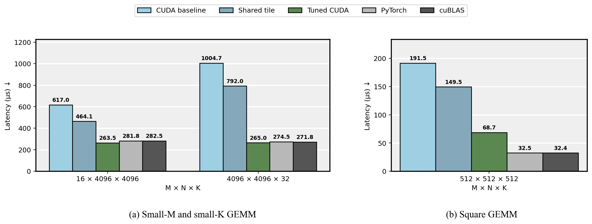
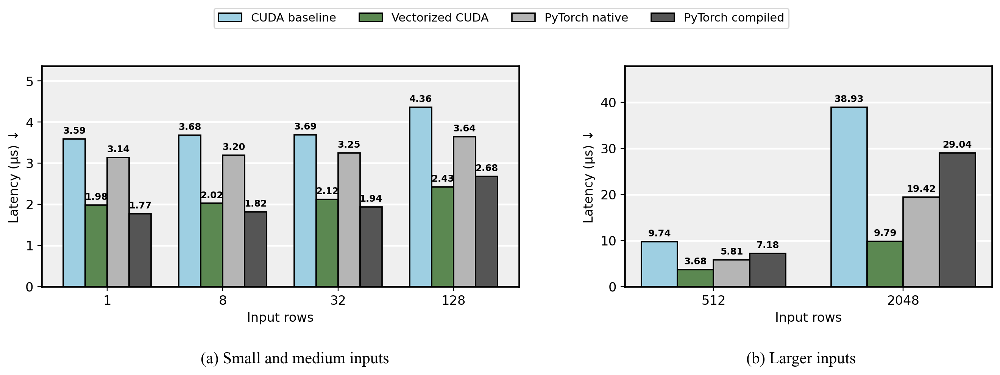
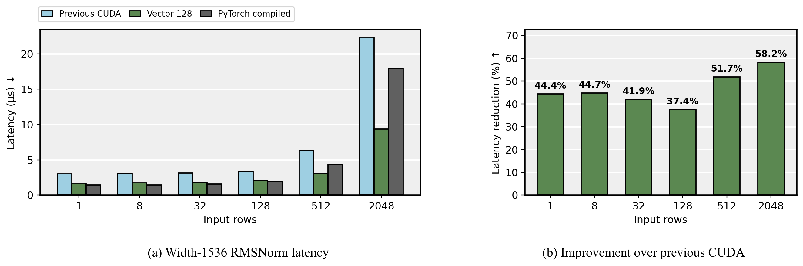

# CUDA Kernel Optimization

CUDA C++ implementations of RMSNorm, affine LayerNorm, and FP32 GEMM through PyTorch extensions. Tuned on NVIDIA L4 for width-1536 normalization and two rectangular GEMM workloads.

## Repository

```text
csrc/          CUDA kernels and C++ bindings
gpu_ops/       Python API and extension loader
reference/     PyTorch comparison implementations
scripts/       Benchmarks and numerical validation
tests/         Operator and execution-semantics tests
results/       Final confirmation measurements
assets/        README figures
```

## Performance

Median GPU latency in microseconds, measured with CUDA Graph replay. Normalization uses BF16; GEMM uses FP32 with TF32 disabled. Each row compares methods from the same confirmation run.

| Operator / input | Tuned CUDA | PyTorch compiled | PyTorch native | Direct cuBLAS | Result |
|---|---:|---:|---:|---:|---|
| RMSNorm · 2048 × 1536 | **9.359** | 17.905 | N/A | N/A | 1.91× vs compiled |
| LayerNorm · 2048 × 1536 | **9.795** | 29.039 | 19.415 | N/A | 2.96× vs compiled; 1.98× vs native |
| GEMM · M16 / N4096 / K4096 | **263.518** | N/A | 281.820 | 282.527 | 6.7% lower latency vs cuBLAS |
| GEMM · M4096 / N4096 / K32 | **265.044** | N/A | 274.468 | 271.799 | 2.5% lower latency vs cuBLAS |
| GEMM · M512 / N512 / K512 | 68.668 | N/A | 32.454 | **32.423** | CUDA latency is 2.12× cuBLAS |

For GEMM, “PyTorch native” is `torch.mm`. Performance depends on workload shape and execution mode; detailed comparisons include cases where PyTorch and cuBLAS remain faster.

The final suite passed **1,330 tests under Compute Sanitizer memcheck with zero errors**.

## FP32 GEMM

The tuned kernels achieve 2.34× and 3.79× speedups over the naive CUDA baseline on the two rectangular FP32 targets. The workloads benefit from different designs. Register blocking alone regresses on the small-M case. Four-way split-K increases its compute grid from 64 to 256 blocks, at the cost of a 1 MiB workspace and a separate reduction kernel. Vectorized tile access improves the small-K case.

Dispatch rules were fixed before evaluating five additional shapes. Tuned CUDA improves on the naive baseline across those shapes, while cuBLAS remains faster on four of the five held-out shapes and the square control.

Comparisons include the full operation, including split-K reduction. PyTorch disables TF32 and direct cuBLAS uses pedantic FP32 compute. CUDA Graph replay and synchronized ordinary-call latency are reported separately. The short-K GEMM advantage in replay disappears in ordinary-call timing, where tuned CUDA and direct cuBLAS are effectively tied.



[CUDA implementation](csrc/gemm.cu)

## LayerNorm

The width-1536 path caches twelve FP32 values per thread and combines warp reductions with vectorized loads/stores, reducing static barrier sites from 20 to 4. Both native PyTorch and the custom implementation launch one kernel; the speedup does not come from reducing kernel-launch count. Statistics and affine arithmetic accumulate in FP32 before the final output cast.



[CUDA implementation](csrc/layernorm.cu)

## RMSNorm

Controlled ablations show that register caching improves latency, while scalar row grouping regresses. The selected width-1536 layout uses 128 threads per row and four-element vector access, with scalar and general-width fallbacks. Reduction, layout-control, and confirmation runs remain separate datasets rather than a chain of cumulative speedups.




[CUDA implementation](csrc/rmsnorm_specialized.cu)

## Build and run

Linux, NVIDIA GPU, CUDA toolkit 12.8 (`nvcc`), and a C++ compiler are required. The recorded GPU stack uses PyTorch 2.8.0+cu128 and NVIDIA L4 (SM 8.9). Run from the repository root.

```bash
python3 -m venv .venv
source .venv/bin/activate
python -m pip install torch==2.8.0 --index-url https://download.pytorch.org/whl/cu128
python -m pip install -r requirements-build.txt
export TORCH_CUDA_ARCH_LIST=8.9
export MAX_JOBS=2
```

The first `initialize()` call builds and loads the extension. Call it once before CUDA tensor operations.

```python
import torch
from gpu_ops import initialize, rmsnorm_vector128

initialize()
x = torch.randn(128, 1536, device="cuda", dtype=torch.bfloat16)
weight = torch.ones(1536, device="cuda", dtype=x.dtype)
y = rmsnorm_vector128(x, weight)
print(y.shape)
```

Run the test suite and one GEMM comparison. Use a fresh output path for each benchmark.

```bash
python -m scripts.sanitizer_workload pytest
python -m scripts.benchmark_gemm --methods pytorch cublas naive tiled tuned --shapes 16x4096x4096 --output results/new-gemm.json
```

## Implementation

I implemented the baseline and optimized CUDA kernels, the guarded shape and alignment dispatch, and the PyTorch extension interface. I built the benchmark and validation tooling, evaluated candidate layouts on L4, and checked numerical behavior, stream ordering, CUDA Graph execution, and sanitizer results.

The exercise provided the operator targets and tiling examples. The implementations preserve Qwen2-compatible RMSNorm cast order, validate vector-access alignment, and retain fallback paths for misaligned storage and general widths. All operators implement forward execution. PyTorch and cuBLAS provide comparison implementations, with SIMT FP32 arithmetic in the custom GEMM.

## Results and source

The final confirmation measurements for all three operators are collected in [measurements.json](results/measurements.json). The CUDA kernels are in [csrc](csrc), the public Python interface is in [gpu_ops](gpu_ops), and baseline implementations are in [reference](reference).

## Validation and measurement

The recorded final L4 pytest run reports **1,330 passed**, also passing memcheck with zero errors. Separate numerical sweeps check **924 RMSNorm**, **720 LayerNorm**, and **768 GEMM** parameter combinations; these are separate workloads and are not added to the pytest total. GEMM synccheck and racecheck each cover 192 cases with zero errors/hazards.

Fresh-process confirmation follows candidate selection. Measurements use 30 randomized interleaved repeats, with 100 calls per replay for normalization and 20 for GEMM. CUDA Graph replay measures GPU execution with captured launches, excluding compilation and Python dispatch. Separate synchronized ordinary-call timings include host dispatch, launch overhead, and allocation. Fixed inputs are reused across repeats. Kernel/source hashes and per-repeat samples are retained in the confirmation dataset. Hardware-counter profiling was blocked by device permissions; design decisions use timing controls, launch topology, and static binary inspection.

## References

The workload exercises define the operator targets and supply tiling examples ([normalization and GEMM](https://dcn5i64sv9ln.feishu.cn/docx/WinMdFbVEobaxbx31VKc5ydOn0b), [small-K GEMM](https://dcn5i64sv9ln.feishu.cn/docx/LPHQdG01Ro3uRwxjrIDcUF5Zntb)). Implementation references include the [PyTorch extension loader](https://docs.pytorch.org/docs/stable/cpp_extension.html), [CUDA stream semantics](https://docs.pytorch.org/docs/stable/notes/cuda.html#cuda-streams), and [Qwen2 RMSNorm](https://github.com/huggingface/transformers/blob/v4.57.1/src/transformers/models/qwen2/modeling_qwen2.py).
